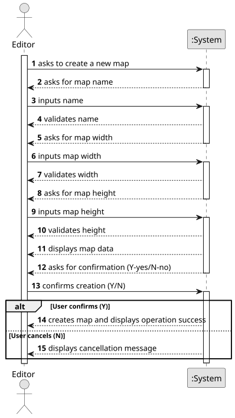

# US001 - Create a map

## 1. Requirements Engineering

### 1.1. User Story Description

As an Editor, I want to create a map with a size and a name.

### 1.2. Customer Specifications and Clarifications 

**From the specifications document:**

> The map must be **rectangular**, with defined width and height, forming a grid of cells.

> Static elements such as **cities and industries** can be placed on the map later.

> The map will be the base for simulation scenarios, where elements are placed and events occur.

**From the client clarifications:**

> **Question:** The map has a size limit?
>
> **Answer:** The limit should be 100000*100000.

> **Question:** Is there a predefined list of sizes, or should users be able to input custom dimensions?
>
> **Answer:** Custom dimensions but suggesting predefined sizes could be a good idea.

> **Question:** Will there be predefined maps, or will all maps be created by editors?
>
> **Answer:** No.

> **Question:** Are there any naming conventions for maps (no special characters, character limit)?
>
> **Answer:** File name.

### 1.3. Acceptance Criteria

* **AC1:** The maps dimensions are positive integers.
* **AC2:** Map name should be a valid file name.
* **AC3:**  The maps should have a scale that states the size of cell map in kms

### 1.4. Found out Dependencies

* Don't have any dependency with other's User Stories.

### 1.5 Input and Output Data

**Input Data:**

* Typed data:
  * Map name (validated against naming rules)
  * Map width (positive integer, validated individually)
  * Map height (positive integer, validated individually)

**Output Data:**

* System feedback during input:
  * Error messages if name is invalid
  * Error messages if width/height are invalid

* Before final creation:
  * System displays entered map details (name, width, height)
  * System asks for confirmation (Y-yes/N-no)

* After confirmation:
  * If confirmed: success message with map details
  * If cancelled: operation aborted message

### 1.6. System Sequence Diagram (SSD)

### 1.7 Other Relevant Remarks

* A confirmation step was added to display the map details and require explicit confirmation before saving.
