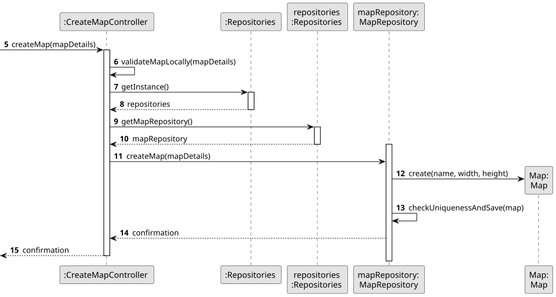
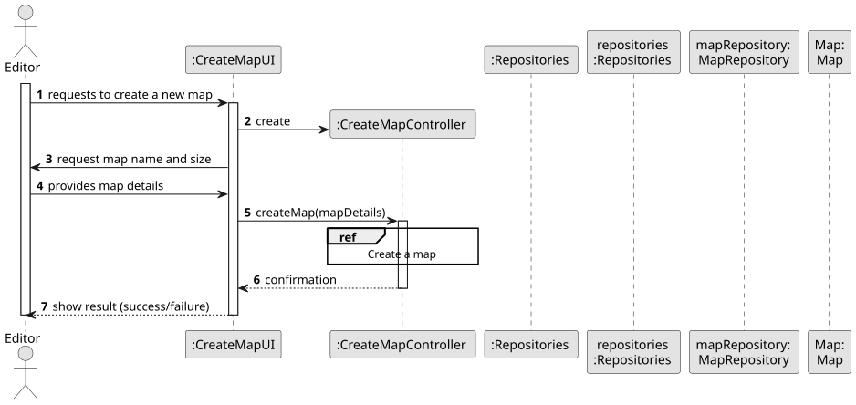
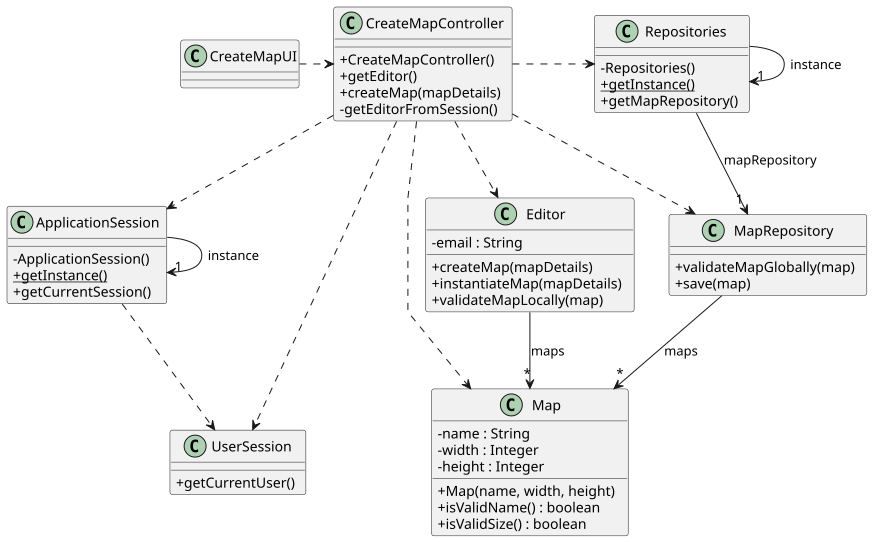

# US001 - Create a map

## 3. Design

### 3.1. Rationale

| Interaction ID | Question: Which class is responsible for...           | Answer                 | Justification (with patterns)                                                                                   |
|:---------------|:------------------------------------------------------|:------------------------|:------------------------------------------------------------------------------------------------------------------|
| Step 1         | ... interacting with the actor?                       | CreateMapUI            | Pure Fabrication: handles all user interactions, and no domain class is suited for this role.                    |
|                | ... coordinating the US?                              | CreateMapController    | Controller: mediates between UI, domain logic and repositories.                                                 |
|                | ... knowing the user using the system?                | UserSession            | IE: knows the current authenticated user.                                                                       |
|                |                                                       | ApplicationSession     | IE: gives access to the active user session.                                                                    |
| Step 2         | ... instantiating the map object?                     | Editor                 | Creator: owns the created Map and has the required data (email, etc.).                                          |
|                | ... validating the map locally (name and size)?       | Editor                 | IE: Editor is responsible for input validation prior to saving.                                                 |
| Step 3         | ... validating the map globally (e.g., uniqueness)?   | MapRepository          | IE: Repository layer checks global constraints and duplicates.                                                  |
| Step 4         | ... saving the new map object?                        | MapRepository          | IE: Responsible for persistence of domain objects.                                                               |
| Step 5         | ... informing the user about success or errors?       | CreateMapUI            | IE: Responsible for displaying feedback to the actor.                                                            |

According to the taken rationale, the conceptual classes promoted to software classes are:

* Map
* Editor

Other software classes (i.e. Pure Fabrication) identified:

* CreateMapUI
* CreateMapController
* Repositories
* MapRepository
* ApplicationSession
* UserSession

## 3.2. Sequence Diagram (SD)

### Full Diagram

This diagram shows the full sequence of interactions between the classes involved in the realization of this user story.

### Split Diagrams

The following diagram shows the same sequence of interactions between the classes involved in the realization of this user story, but it is split in partial diagrams to better illustrate the interactions between the classes.

It uses Interaction Occurrence (a.k.a. Interaction Use).

**Create map Partial SD**

## 3.3. Class Diagram (CD)

