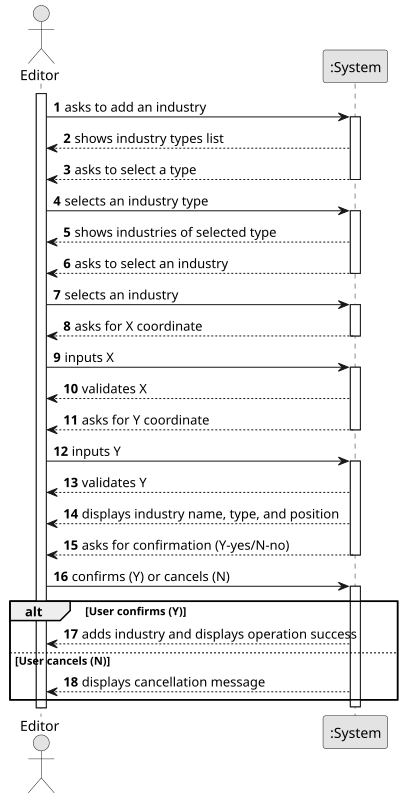

# US002 - Add an industry

## 1. Requirements Engineering

### 1.1. User Story Description

As an Editor, I want to add an industry (selected from the available industries) in a position XY of the selected (current) map.

### 1.2. Customer Specifications and Clarifications 

**From the specifications document:**

>	 There are three different types of industries :
>* Primary sector industries (generate resources, such as mines and farms)
>* Transforming industries (Transform resources provided by the Primary Sector into new products)
>* Mixed industries (Ports pottencially have the capacity, depending on what is defined in the scneario, to import or export any cargo)

> Industries must be placed inside the map boundaries.

> It is not allowed to place an industry over an existing city or another industry (overbuilding is forbidden).

> The type and behavior of the industry affect how it interacts with cargo in the simulation.

**From the client clarifications:**

> **Question:** When adding a new industry to a map, is there any other necessary input aside from position and industry type?
>
> **Answer:** No.

> **Question:** As an editor, when adding a new industry, do I need to check for overbuild?
>
> **Answer:** Yes.

### 1.3. Acceptance Criteria

* N/A

### 1.4. Found out Dependencies

* There is a dependency on "US001 - Create a map" there must be a map to choose a position XY. 

### 1.5 Input and Output Data

**Input Data:**

* Typed data:
  * X coordinate (positive integer, validated individually)
  * Y coordinate (positive integer, validated individually)

* Selected data:
  * A map (must already exist and be selected)
  * An industry type (Primary, Transforming, or Mixed)
  * An industry name (filtered by the selected type)

**Output Data:**

* System feedback during input:
  * Error messages if type or name is invalid
  * Error messages if coordinates are invalid or outside map bounds
  * Error message if the position overlaps another city or industry

* Before final creation:
  * System displays industry type, name, and position
  * System asks for confirmation (Y-yes/N-no)

* After confirmation:
  * If confirmed: success message with industry details
  * If cancelled: operation aborted message

### 1.6. System Sequence Diagram (SSD)

### 1.7 Other Relevant Remarks

* Industries are placed directly on the map and affect cargo generation/processing.
* Industry behavior (e.g., cargo input/output) depends on its type and scenario rules.