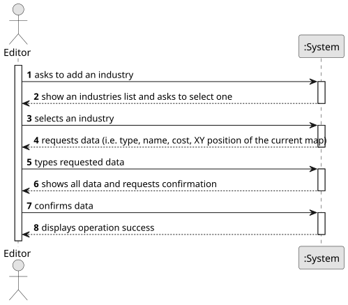

# US002 - Add an industry

## 1. Requirements Engineering

### 1.1. User Story Description

As an Editor, I want to add an industry (selected from the available industries) in a position XY of the selected (current) map.

### 1.2. Customer Specifications and Clarifications 

**From the specifications document:**

>	 There are three different types of industries :
>* Primary sector industries (generate resources, such as mines and farms)
>* Transforming industries (Transform resources provided by the Primary Sector into new products)
>* Mixed industries (Ports pottencially have the capacity, depending on what is defined in the scneario, to import or export any cargo)

**From the client clarifications:**

> **Question:** Which is the unit of measurement used to estimate duration?
>
> **Answer:** Duration is estimated in days.

> **Question:** Monetary data is expressed in any particular currency?
>
> **Answer:** Monetary data (e.g. estimated cost of a task) is indicated in POT (virtual currency internal to the platform).

### 1.3. Acceptance Criteria

### 1.4. Found out Dependencies

* There is a dependency on "US001 - Create a map" there must be a map to choose a position XY. 

### 1.5 Input and Output Data

**Input Data:**

* Typed data:
    * an industry type
    * an industry name
    * an XY position

* Selected data:
    * a map

**Output Data:**

* Operation success

### 1.6. System Sequence Diagram (SSD)

**_Other alternatives might exist._**

### 1.7 Other Relevant Remarks

* 