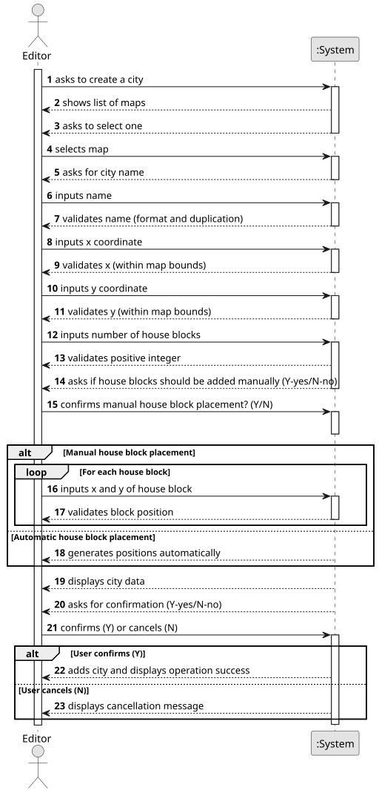

# US003 - Adds a City

## 1. Requirements Engineering

### 1.1. User Story Description

As an Editor, I want to add a city in a position XY of the selected
map, with a name and a positive number of house blocks.

### 1.2. Customer Specifications and Clarifications 

**From the specifications document:**

>	Each task is characterized by having a unique reference per organization, a designation, an informal and a technical description, an estimated duration and cost, as well as a task category. 

>	As long as it is not published, access to the task is exclusive to the employees of the respective organization. 

**From the client clarifications:**

> **Question:** Which is the unit of measurement used to estimate duration?
>
> **Answer:** Duration is estimated in days.

> **Question:** Monetary data is expressed in any particular currency?
>
> **Answer:** Monetary data (e.g. estimated cost of a task) is indicated in POT (virtual currency internal to the platform).

### 1.3. Acceptance Criteria

* **AC1:** A city name cannot have special characters or digits.
* **AC2:** The house blocks can be assigned manually or automatically (randomly around the city tag position).

### 1.4. Found out Dependencies

* There is a dependency on "US001 - Create a map" as there must be at least one map to creat the city.

### 1.5 Input and Output Data

**Input Data:**

* Typed data:
    * City name
    * XY coordinates
    * Number of house blocks
	
* Selected data:
    * Manual or automatic (random) house block placement

**Output Data:**

* (In)Success of the operation

### 1.6. System Sequence Diagram (SSD)

**_Other alternatives might exist._**

### 1.7 Other Relevant Remarks

* A city cannot be placed on top of another city or industry.