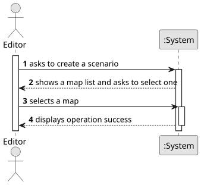

# US004 - Create a Scenario

## 1. Requirements Engineering

### 1.1. User Story Description

As an editor, I want to create a new scenario in order to be further published.

### 1.2. Customer Specifications and Clarifications 

**From the specifications document:**

>	Each task is characterized by having a unique reference per organization, a designation, an informal and a technical description, an estimated duration and cost, as well as a task category. 

>	As long as it is not published, access to the task is exclusive to the employees of the respective organization. 

**From the client clarifications:**

> **Question:** Which is the unit of measurement used to estimate duration?
>
> **Answer:** Duration is estimated in days.

> **Question:** Monetary data is expressed in any particular currency?
>
> **Answer:** Monetary data (e.g. estimated cost of a task) is indicated in POT (virtual currency internal to the platform).

### 1.3. Acceptance Criteria

* **AC1:**  Definition of the behaviour of ports, which cargoes they import/export and/or transform;
* **AC2:** Definition of the available locomotion types (steam, diesel, and/or
  electric).
* **AC3:** (Re)Definition of the factors that alter the generation (frequency)
  of generating industries
### 1.4. Found out Dependencies

* There are no dependencies to other requirements.

### 1.5 Input and Output Data

* There aren't any input or output data.

### 1.6. System Sequence Diagram (SSD)

**_Other alternatives might exist._**

### 1.7 Other Relevant Remarks

* The created scenario stays in a "not published" state in order to distinguish from "published" scenarios.