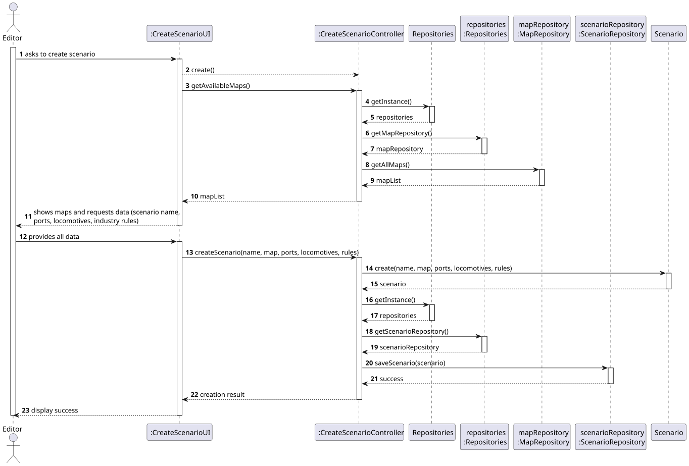
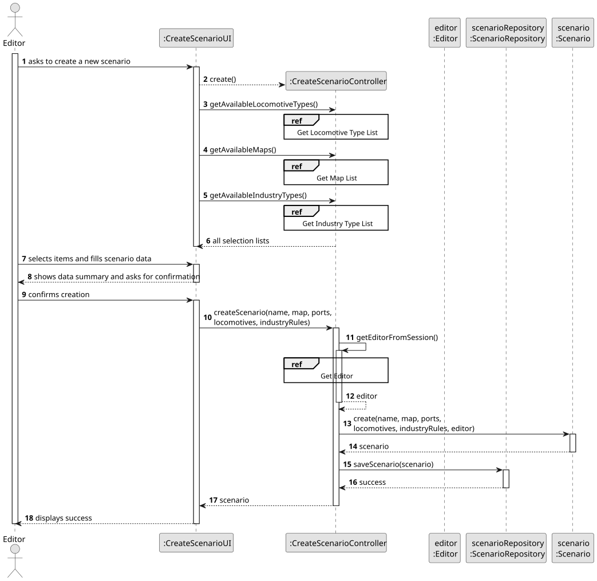
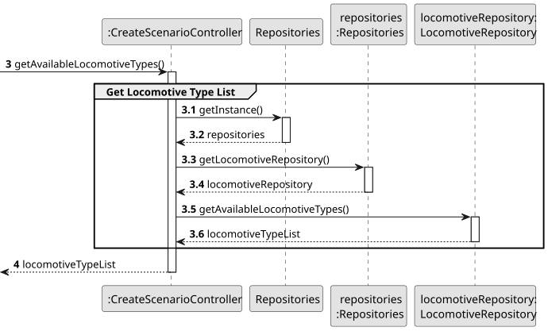
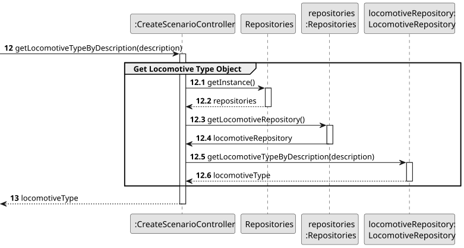
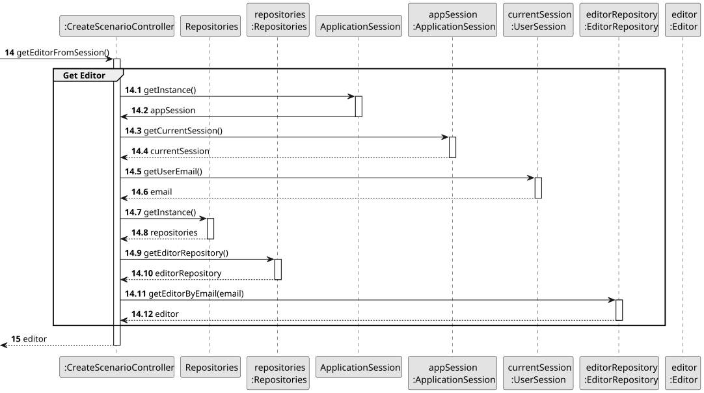
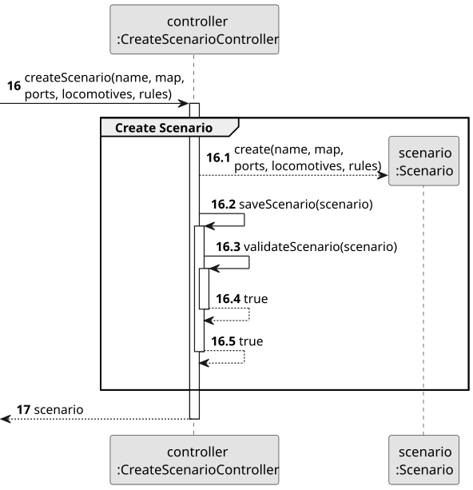
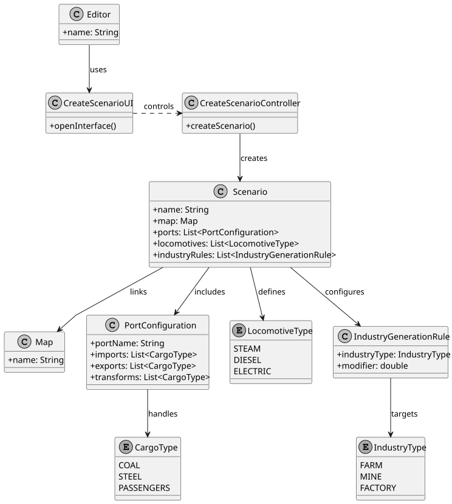

# US004 - Create a Scenario

## 3. Design

### 3.1. Rationale

| Interaction ID | Question: Which class is responsible for...             | Answer                    | Justification (with patterns)                                                                                   |
|----------------|----------------------------------------------------------|----------------------------|------------------------------------------------------------------------------------------------------------------|
| Step 1         | ... interacting with the actor?                          | `CreateScenarioUI`         | Pure Fabrication: UI handles user input/output and does not belong to the domain model.                         |
|                | ... coordinating the US?                                 | `CreateScenarioController` | Controller: Manages the logic flow between UI, session, repositories, and domain objects.                       |
|                | ... knowing the user using the system?                   | `UserSession`              | IE: Holds the session details of the logged-in user.                                                            |
|                |                                                          | `Editor`                   | IE: Represents the authenticated user performing the scenario creation.                                         |
| Step 2         | ... knowing all existing locomotive types?              | `Repositories`             | IE: Acts as a gateway to access domain data repositories.                                                       |
|                |                                                          | `LocomotiveRepository`     | HC + LC: High cohesion and low coupling for locomotive-specific data access.                                    |
| Step 3         | ... knowing all existing maps?                          | `MapRepository`            | IE: Encapsulates access to map-related data.                                                                    |
| Step 4         | ... knowing all available industry types?               | `IndustryRepository`       | IE: Provides a list of supported industry types available for scenario configuration.                           |
| Step 5         | ... saving selected options and user input?             | `CreateScenarioUI`         | IE: Responsible for holding the form data during interaction.                                                   |
| Step 6         | ... showing data and requesting confirmation?           | `CreateScenarioUI`         | IE: Handles all user-facing confirmation steps.                                                                 |
| Step 7         | ... instantiating a new `Scenario`?                     | `CreateScenarioController` | Creator: Owns and combines all input to create the domain object.                                               |
|                | ... associating the `Editor` to the scenario?           | `CreateScenarioController` | IE: Uses session information to get the logged-in editor.                                                       |
|                | ... saving the scenario?                                | `ScenarioRepository`       | IE: Manages scenario persistence.                                                                               |
|                | ... validating local data?                              | `Scenario`                 | IE: Responsible for validating its own state.                                                                   |
|                | ... validating global constraints (e.g., name conflict)?| `ScenarioRepository`       | IE: Can check all persisted scenarios for validation.                                                           |
| Step 8         | ... informing operation success?                        | `CreateScenarioUI`         | IE: Handles final interaction feedback to the user.                                                             |

### Systematization ##

According to the taken rationale, the conceptual classes promoted to software classes are: 

* Scenario
* Map
* PortConfiguration
* Editor

Other software classes (i.e. Pure Fabrication) identified: 

* CreateScenarioUI  
* CreateScenarioController
* Repositories
* MapRepository
* ScenarioRepository
* LocomotiveRepository
* IndustryRepository
* ApplicationSession
* UserSession

## 3.2. Sequence Diagram (SD)

### Full Diagram

This diagram shows the full sequence of interactions between the classes involved in the realization of this user story.

### Split Diagrams

The following diagram shows the same sequence of interactions between the classes involved in the realization of this user story, but it is split in partial diagrams to better illustrate the interactions between the classes.

It uses Interaction Occurrence (a.k.a. Interaction Use).

**Get Task Category List Partial SD**

**Get Task Category Object**

**Get Employee**

**Create Task**

## 3.3. Class Diagram (CD)

