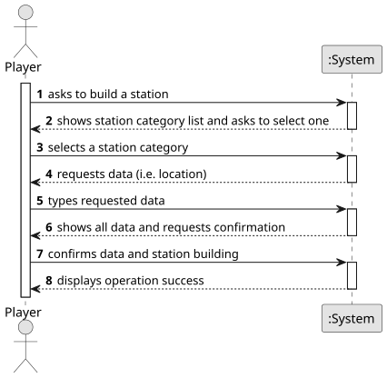

# US005 - Build a station

## 1. Requirements Engineering

### 1.1. User Story Description

As a Player, I want to build station (can be a depot, a station or a terminal) with a location in the current map.

### 1.2. Customer Specifications and Clarifications 

**From the specifications document:**

>   There are three types of stations:
>   * Depot: Costs 50k, has a 3x3 radius
>   * Station: Costs 100k, has a 4x4 radius
>   * Terminal: Costs 200k, has a 5x5 radius
 
>   The system should propose a name for the station based on the closest city and the station (e.g., Porto Terminal, Ovar Station or Silvalde Depot).
>
>   For Depots and Terminals, the center is the geometric center. For Stations, the player must define the center (NE, SE, NW, SW).

**From the client clarifications:**

> **Question:** Should there be a predefined name for the station?
>
> **Answer:** There should be a name suggestion based on the nearest city and the type of station.

> **Question:** If overbuilding occurs, the program stops running and the game ends or simply gives an error message and asks again for the station construction place?
>
> **Answer:** Overbuilding in the Editor is possible, the existing building is replaced for the new one. Overbuilding in the Simulator is NOT possible, the player gets a warning and games continues.

> **Question** Should users have options to select different station types (Depot, Station, Terminal) based on the game rules?
> 
> **Answer** No, a player can build depots, stations and terminal as far he have available budget and there no overbuilding.

### 1.3. Acceptance Criteria

* **AC1:** Overbuilding is not possible.
* **AC2:** The system suggests a name for the station based on the closest city and station type.
* **AC3:**  

### 1.4. Found out Dependencies

* There is a dependency on "US001 - Create a map" as there must be a map to the station to be built on.

### 1.5 Input and Output Data

**Input Data:**

* Typed data:
    * selected location on the map
   
* Selected data:
    * a station type
    * center (in the case of a station)

**Output Data:**

* List of station types
* (In)Success of the operation

### 1.6. System Sequence Diagram (SSD)

**_Other alternatives might exist._**

### 1.7 Other Relevant Remarks

* When built, a station consists of just one building, which can be upgraded with other buildings that can increase the station’s performance.