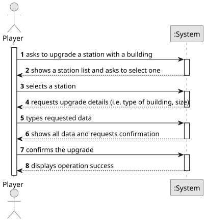

# US006 - Upgrade a station with a building

## 1. Requirements Engineering

### 1.1. User Story Description

As a Player, I want to upgrade a selected station with a building. Each type of station improvement has a date from which it is available. Some equipments are mutually exclusive (e.g., small and grand hotel) and some equipments/buildings replace others (the telegraph was initially used to facilitate the operation of trains at stations, and was later replaced by the telephone, so after the advent of telephone, telegraph is no more available).

### 1.2. Customer Specifications and Clarifications 

**From the specifications document:**
> When built, a station consists of just one building, which can be upgraded with other building that can increase the station's performance.

>	The buildings/equipments available are:
> * telegraph, then later replaced by telephone
> * small or grand hotel
> * small or large cafe
> * customs
> * post office
> * silo
> * liquid storage

**From the client clarifications:**

> **Question:** Is there a limit on the number of buildings a station can be upgraded with?
>
> **Answer:** No.

> **Question:** Does the upgrade from telegraph to telephone occur automatically once a certain year is reached?
>
> **Answer:** There are no automatic updates; When a new building is available, the player can buy it and then the previous building is replaced.

> **Question:** In the statement, the example of a small hotel and a large hotel is given as mutually exclusive facilities. Does this mean that all upgrades of the same type are always mutually exclusive? Or, for example, is it possible to have more than one unit of liquid storage at the same station?
>
> **Answer:** There are no automatic updates; When a new building is available, the player can buy it and then the previous building is replaced.

> 
> **Question:** Does the upgrade from telegraph to telephone occur automatically once a certain year is reached?
>
>**Answer:** There are no automatic updates; When a new building is available, the player can buy it and then the previous building is replaced.

### 1.3. Acceptance Criteria

* AC1- Reject upgrades with invalid dates, for example, the telephone before 1880;
* AC2- Prevent the fact that some equipments are mutually exclusive, for example, small and grand hotel;
* AC3- As some equipments replace others, the previous one needs to be removed;

### 1.4. Found out Dependencies

* There is a dependency on "US005 - Build a Station" since stations must exist before they can be upgraded.
* There is a dependency on "US004 - Create a Scenario" since when you create a scenario, it provides the current year for date validation.

### 1.5 Input and Output Data

**Input Data:**

* Typed data:
    * type of building
    * size of the building
	
* Selected data:
    * a station 

**Output Data:**
* (In)Success of the operation

### 1.6. System Sequence Diagram (SSD)

**_Other alternatives might exist._**

### 1.7 Other Relevant Remarks