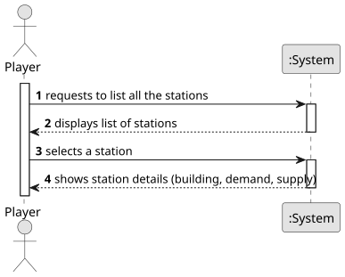

# US007 - Sees the Details of a Station

## 1. Requirements Engineering

### 1.1. User Story Description

As a Player, I want to list all the stations to select one to see its
details, including the existing building and the demand/supply cargoes.

### 1.2. Customer Specifications and Clarifications 

**From the specifications document:**

>	Each task is characterized by having a unique reference per organization, a designation, an informal and a technical description, an estimated duration and cost, as well as a task category. 

**From the client clarifications:**

> **Question:** Which is the unit of measurement used to estimate duration?
>
> **Answer:** Duration is estimated in days.

> **Question:** Monetary data is expressed in any particular currency?
>
> **Answer:** Monetary data (e.g. estimated cost of a task) is indicated in POT (virtual currency internal to the platform).

### 1.3. Acceptance Criteria

There is no acceptance criteria yet.

### 1.4. Found out Dependencies

* There is a dependency on "US005 - Create a station" as there must be at least one station to list.

### 1.5 Input and Output Data

**Input Data:**

* Typed data:
    * Request to list stations
	
* Selected data:
    * a specific station chosen by the player

**Output Data:**

* List of available stations
* Details of the selected station, including:
    * Existing building
    * Demand cargo list
    * Supply cargo list

### 1.6. System Sequence Diagram (SSD)

**_Other alternatives might exist._**

### 1.7 Other Relevant Remarks

* If no stations exist, the system should display an appropriate message.