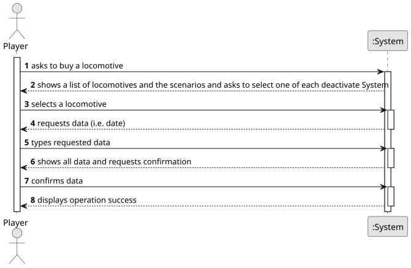

# US009 - Buy a locomotive

## 1. Requirements Engineering

### 1.1. User Story Description

As a player, I want to buy a new locomotive.

### 1.2. Customer Specifications and Clarifications 

**From the specifications document:**

>	Each task is characterized by having a unique reference per organization, a designation, an informal and a technical description, an estimated duration and cost, as well as a task category. 

>	As long as it is not published, access to the task is exclusive to the employees of the respective organization. 

**From the client clarifications:**

> **Question:** Which is the unit of measurement used to estimate duration?
>
> **Answer:** Duration is estimated in days.

> **Question:** Monetary data is expressed in any particular currency?
>
> **Answer:** Monetary data (e.g. estimated cost of a task) is indicated in POT (virtual currency internal to the platform).

### 1.3. Acceptance Criteria

* **AC1:** The player should choose the locomotive from a list of available
  locomotives for the scenario as well as a current date. 
* 
### 1.4. Found out Dependencies

* There are no dependencies to other requirements.

### 1.5 Input and Output Data

**Input Data:**

* Typed data:
    * a date
	
* Selected data:
    * a locomotive

**Output Data:**

* List of existing locomotive categories
* Current date
* (In)Success of the operation

### 1.6. System Sequence Diagram (SSD)

**_Other alternatives might exist._**
