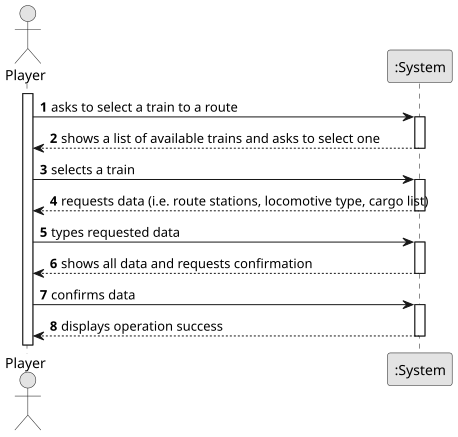

# US010 - Assign a train to a route

## 1. Requirements Engineering

### 1.1. User Story Description

As a Player, I want to assign a selected train to a route with valid stations and the respective list of cargoes to be picked up in each station

### 1.2. Customer Specifications and Clarifications 

**From the specifications document:**

>	 A route is a list of stations where the train passes.

>	The cargo types are passengers, mail, coal, iron ore, steel and cars. 

**From the client clarifications:**

> **Question:** Which is the unit of measurement used to estimate duration?
>
> **Answer:** Duration is estimated in days.

> **Question:** Monetary data is expressed in any particular currency?
>
> **Answer:** Monetary data (e.g. estimated cost of a task) is indicated in POT (virtual currency internal to the platform).

### 1.3. Acceptance Criteria

* There are no AC yet

### 1.4. Found out Dependencies

* There is a dependency on "US008 - Build a railway line" because to exist a route, stations need to be connected by a railway line first.
* There is a dependency on "US009 - Buy a train" because it is needed to buy a locomotive to assign a train.
* There is a dependency on "US012 - Create a simulator" because as we need a list of cargoes to be picked up, cargoes need to be generated

### 1.5 Input and Output Data

**Input Data:**

* Typed data:
    * route
    * cargo
	
* Selected data:
    * train 

**Output Data:**

* (In)Success of the operation

### 1.6. System Sequence Diagram (SSD)

**_Other alternatives might exist._**

### 1.7 Other Relevant Remarks