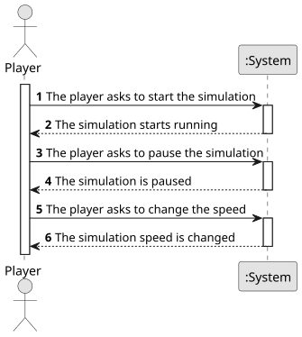

# US012 - Create a simulator

## 1. Requirements Engineering

### 1.1. User Story Description

As a Player, I want to control the simulator to observe my railway network's operation.

### 1.2. Customer Specifications and Clarifications 

**From the specifications document:**

>	Time progresses in simulated months/years
> 
> Automatic cargo generation at stations
> 
> Train movement between stations  

**From the client clarifications:**

> **Question:** A simulação é corrida mapa a mapa ou para todos os mapas existentes?
> 
> **Answer:**
No contexto da simulation o jogador escolhe um cenário para jogar, associado ao cenário existe obrigatoriamente um mapa.
A execução do simulador para uma cenário é designada de simulação.

### 1.3. Acceptance Criteria

* **AC1:** Time advancement: Confirms year changes
* **AC2:** Cargo generation: Check station inventories after simulation steps.
* **AC3:** Train movement: Verify position updates

### 1.4. Found out Dependencies

- Requires completed scenarios (US04)
- Needs functional trains (US09) and routes (US10)

### 1.5 Input and Output Data

**Input Data:**

* Typed data:
    * command start

**Output Data:**

* (In)Success of the operation

### 1.6. System Sequence Diagram (SSD)

**_Other alternatives might exist._**

### 1.7 Other Relevant Remarks

- N/A