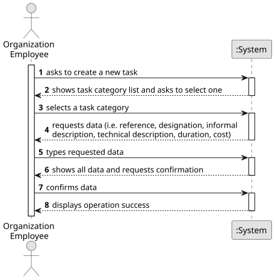

# US013 - Verify if a train can travel between two stations

## 1. Requirements Engineering

### 1.1. User Story Description

As a Player, given a railway with stations and lines connecting
pairs of stations, I want to verify if a specific train (steam, diesel, or
electric powered) can travel between two stations belonging to the rail
network (or from any type of station to another of the same type).

### 1.2. Customer Specifications and Clarifications 

**From the specifications document:**

>	Each task is characterized by having a unique reference per organization, a designation, an informal and a technical description, an estimated duration and cost, as well as a task category. 

>	As long as it is not published, access to the task is exclusive to the employees of the respective organization. 

**From the client clarifications:**

> **Question:** Which is the unit of measurement used to estimate duration?
>
> **Answer:** Duration is estimated in days.

> **Question:** Monetary data is expressed in any particular currency?
>
> **Answer:** Monetary data (e.g. estimated cost of a task) is indicated in POT (virtual currency internal to the platform).

### 1.3. Acceptance Criteria

* **AC1:** The player should be able to choose the type of train (steam,
  diesel or electric) and station type (depot, station or terminal) in real
  time.
* **AC2:** A visualization of the stations, and the lines connecting stations
  of this scenario (using, for example, Graphviz or GraphStream packages) should be displayed to the player, where electrified railway lines
  are drawn with a different color from the others.
* **AC3:** All implemented procedures (except the used for graphic visualization) must use primitive operations only, and not existing functions
  in JAVA libraries.
* **AC4:** The algorithm(s) implemented to solve this problem should
  be documented/detailed in the repository documentation (using markdown format).

### 1.4. Found out Dependencies

* There is a dependency on "US003 - Create a task category" as there must be at least one task category to classify the task being created.

### 1.5 Input and Output Data

**Input Data:**

* Typed data:
    * a reference
    * a designation 
    * an informal description
    * a technical description
    * an estimated duration
    * an estimated cost
	
* Selected data:
    * a task category 

**Output Data:**

* List of existing task categories
* (In)Success of the operation

### 1.6. System Sequence Diagram (SSD)

**_Other alternatives might exist._**

### 1.7 Other Relevant Remarks

* The created task stays in a "not published" state in order to distinguish from "published" tasks.