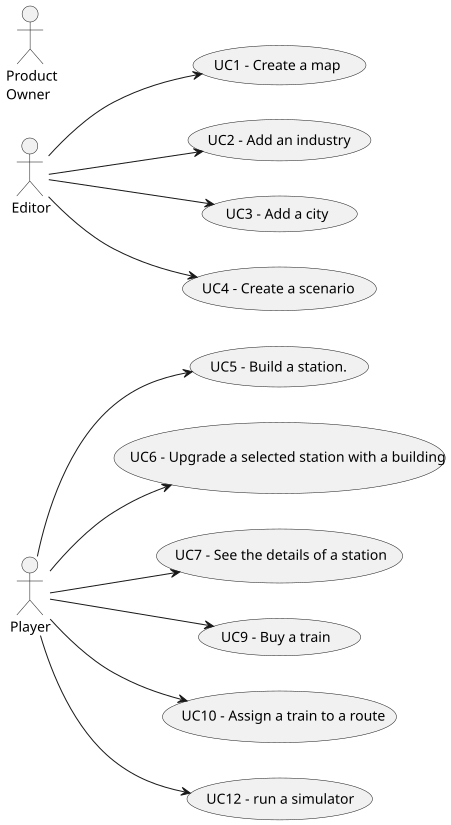

g# Use Case Diagram (UCD)

**In the scope of this project, there is a direct relationship of _1 to 1_ between Use Cases (UC) and User Stories (US).**

However, be aware, this is a pedagogical simplification. On further projects and course units there may also exist _1 to N **and/or** N to 1_ relationships between UC and US.

**Insert below the Use Case Diagram in a SVG format**

**For each UC/US, it must be provided evidences of applying main activities of the software development process (requirements, analysis, design, tests and code). Gather those evidences on a separate file for each UC/US and set up a link as suggested below.**

# Use Cases / User Stories

| UC/US | Description                                                                                                   |                   
|:------|:--------------------------------------------------------------------------------------------------------------|
| US001 | [Create a map](../../US001/01.requirements-engineering/US001-requirements.md)                                 |
| US002 | [Add an industry](../../US002/01.requirements-engineering/US002-requirements.md)                              |
| US003 | [Add a city](../../US003/01.requirements-engineering/US003-requirements.md)                                   |
| US004 | [Create a scenario](../../US004/01.requirements-engineering/US004-requirements.md)                            |
| US005 | [Build a station](../../US005/01.requirements-engineering/US005-requirements.md)                              |
| US006 | [Upgrade a selected station](../../US006/01.requirements-engineering/US006-requirements.md)                   |
| US007 | [List all the stations](../../US007/01.requirements-engineering/US007-requirements.md)                        |
| US009 | [Buy a train](../../US009/01.requirements-engineering/US009-requirements.md)                                  |
| US010 | [Assign a train to a route](../../US010/01.requirements-engineering/US010-requirements.md)                    |
| US012 | [Run a simulator](../../US012/01.requirements-engineering/US012-requirements.md)                              |
| US013 | [Verify a train path](../../US012/01.requirements-engineering/US012-requirements.md)                          |
| US014 | [Plan maintenance route](../../US012/01.requirements-engineering/US012-requirements.md)                       |
| US015 | [Analyse station profit](../../US012/01.requirements-engineering/US012-requirements.md)                       |
| US016 | [Compare passenger arrivals](../../US012/01.requirements-engineering/US012-requirements.md)                   |
| US017 | [Analyse cargo distribution](../../US012/01.requirements-engineering/US012-requirements.md)                   |
| US018 | [Visualize train/passenger/mail distribuction](../../US012/01.requirements-engineering/US012-requirements.md) |
