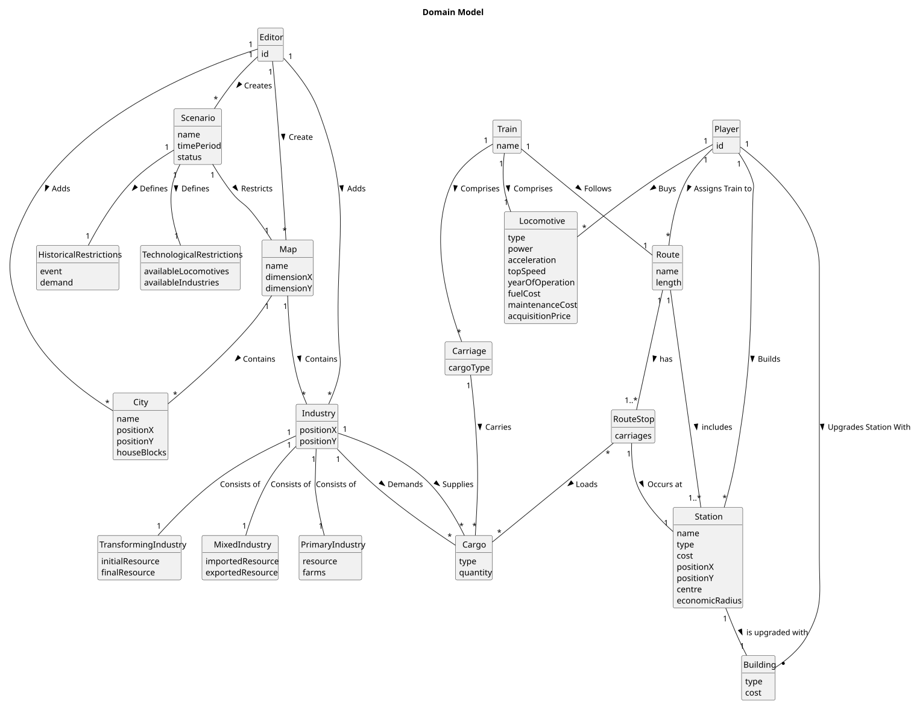

# OO Analysis

The construction process of the domain model is based on the client specifications, especially the nouns (for _concepts_) and verbs (for _relations_) used.

## Rationale to identify domain conceptual classes
To identify domain conceptual classes, start by making a list of candidate conceptual classes inspired by the list of categories suggested in the book "Applying UML and Patterns: An Introduction to Object-Oriented Analysis and Design and Iterative Development".

### _Conceptual Class Category List_

**Business Transactions**

* CargoTransaction

---

**Transaction Line Items**

* CargoItem 

---

**Product/Service related to a Transaction or Transaction Line Item**

* Passengers
* Mail
* Coal
* Iron ore
* Steel
* Final products

---

**Transaction Records**

* OperationLog
* BudgetRecord

---  

**Roles of People or Organizations**

* Product Owner
* Editor
* Player

---

**Places**

* Map
* City
* Industry (Primary/Transforming/Mixed)
* Station (Depot/Station/Terminal)

---

**Noteworthy Events**

* War
* Vaccination campaign

---

**Physical Objects**

* Train
* Locomotive (Steam/Diesel/Electric)
* Carriage
* Buildings (Telegraph/Café/Customs/Post office/Hotel/Silo/Liquid storage)

---

**Descriptions of Things**

* ScenarioDescription 
* TechnologicalRestrictions 
* HistoricalRestrictions

---

**Catalogs**

* LocomotiveCatalog
* CarriageCatalog
* IndustryCatalog
* StationCatalog

---

**Containers**

* Route

---

**Elements of Containers**

* RouteStop

---

**Organizations**

* TheCompany (ou RailwayOperator)

---

**Other External/Collaborating Systems**

* MapService

---

**Records of finance, work, contracts, legal matters**

* N/A

---

**Financial Instruments**

* N/a
    
---

**Documents mentioned/used to perform some work/**

* N/A
---

## Rationale to identify associations between conceptual classes

| Concept (A) |      Association      |               Concept (B) |
|-------------|:---------------------:|--------------------------:|
| Editor      |        creates        |                  Scenario |
| Editor      |        creates        |                       Map |
| Editor      |         adds          |                  Industry |
| Editor      | adds                  |                      City |
| Scenario    |        defines        |    HistoricalRestrictions |
| Scenario    |        defines        | TechnologicalRestrictions |
| Scenario    |       restricts       |                       Map |
| Map         |       contains        |                      City |
| Map         |       contains        |                  Industry |
| Industry    |      consists of      |      TransformingIndustry |
| Industry    |      consists of      |             MixedIndustry |
| Industry    |      consists of      |           PrimaryIndustry |
| Industry    |        demands        |                     Cargo |
| Industry    |       supplies        |                     Cargo |
| Player      |        builds         |                     Route |
| Player      |   assigns train to    |                     Route |
| Player      | upgrades station with |                  Building |
| Player      |         buys          |                     Train |
| Train       |       comprises       |                Locomotive |
| Train       |       comprises       |                  Carriage |
| Carriage    |        carries        |                     Cargo |
| Route       |          has          |                 RouteStop |
| RouteStop   |       occurs at       |                   Station |
| RouteStop   |         loads         |                     Cargo |
| RouteStop   |       includes        |                  Carriage |
| Station     |   is upgraded with    |                  Building |

## Domain Model

**Do NOT forget to identify concept atributes too.**

**Insert below the Domain Model Diagram in a SVG format**

